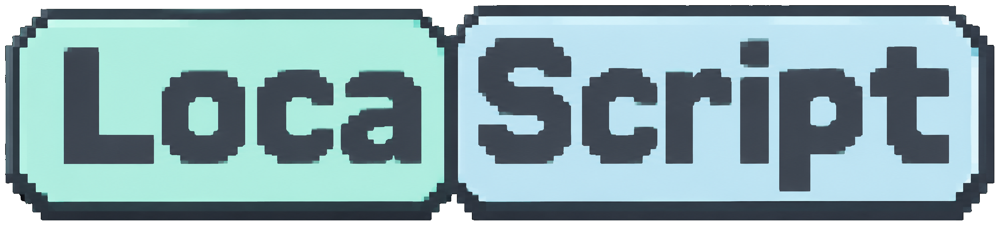

<h1 align="center"></h1>

<p align="center"><strong>Linguagem de marcação para mensagens de jogos</strong></p>

---

LocaScript é uma linguagem de marcação para mensagens de jogos. Ela permite interpolar variáveis, escolher textos por categoria plural ou por valor, aplicar formatadores e incluir tags de estilo. O projeto contém o lexer e o parser ANTLR, a construção e validação da AST, o interpretador e um playground web.

```locascript
Você encontrou { $quantidade ->
    [zero]  nenhuma moeda.
    [one]   1 moeda de ouro.
    [*]     # moedas de ouro.
}
```

A especificação da linguagem está em [minha-linguagem/docs/especificacao.md](minha-linguagem/docs/especificacao.md). O passo a passo detalhado para iniciar o playground está em [minha-linguagem/docs/rodar-playground.md](minha-linguagem/docs/rodar-playground.md).

## Estrutura do repositório

- `minha-linguagem/gramatica/`: gramáticas ANTLR do lexer e parser.
- `minha-linguagem/gerado/`: código gerado pelo ANTLR; não é versionado e deve ser criado localmente.
- `minha-linguagem/src/`: lexer/parser de linha de comando, AST, análise semântica, interpretador e servidor Flask.
- `minha-linguagem/static/`: interface do playground.
- `minha-linguagem/exemplos/`: mensagens de exemplo válidas e inválidas.
- `minha-linguagem/tests/`: testes automatizados.
- `render.yaml` e `minha-linguagem/Dockerfile`: configuração do deploy Docker no Render.

## Iniciar o playground

Os comandos abaixo partem da raiz do repositório. É necessário Python 3.10 ou mais recente. O ambiente virtual mantém as dependências isoladas do Python global.

### Windows (PowerShell)

```powershell
cd minha-linguagem
py -m venv .venv
.\.venv\Scripts\Activate.ps1
python -m pip install --upgrade pip
python -m pip install -r requirements.txt
python -m pip install antlr4-tools==0.2.2
.\gerar.ps1
python src\servidor.py
```

Na primeira geração, `antlr4-tools` pode solicitar o download de um JRE. Quando o servidor indicar `http://127.0.0.1:5000`, abra esse endereço no navegador. Pressione `Ctrl+C` no terminal para encerrá-lo.

Se o ambiente `.venv` já existir, não crie outro. Ative-o e instale apenas as dependências que faltarem. Se a ativação for bloqueada pela política de execução do PowerShell, use `\.venv\Scripts\python.exe` no lugar de `python`; para gerar, ative o ambiente primeiro para que `gerar.ps1` encontre o `antlr4.exe` instalado nele.

### Linux

Em Debian/Ubuntu, instale os pré-requisitos do sistema e rode os comandos abaixo:

```bash
sudo apt update
sudo apt install -y python3 python3-venv python3-pip default-jre-headless
cd minha-linguagem
python3 -m venv .venv
source .venv/bin/activate
python -m pip install --upgrade pip
python -m pip install -r requirements.txt
python -m pip install antlr4-tools==0.2.2
bash gerar.sh
python src/servidor.py
```

Abra `http://127.0.0.1:5000` no navegador. Pressione `Ctrl+C` para encerrar o servidor.

Os scripts de geração criam os módulos Python do lexer e do parser em `gerado/`. A pasta é ignorada pelo Git, então execute a geração ao preparar um clone novo. Depois que `.venv/` e `gerado/` estiverem preparados, inicie novamente com `source .venv/bin/activate` e `python src/servidor.py` (no Windows, ative `.venv` e use o mesmo comando Python).

## Verificar a instalação

Com o servidor ativo, a interface deve abrir em `http://127.0.0.1:5000`. A rota de saúde responde com `{"status":"ok"}`:

```bash
curl http://127.0.0.1:5000/saude
```

No PowerShell, use `Invoke-RestMethod http://127.0.0.1:5000/saude`.

## Testes

As dependências de teste já estão em `requirements.txt`. A partir de `minha-linguagem/`, com o ambiente virtual ativado:

```bash
python -m pytest
```

## Deploy no Render

O repositório inclui [render.yaml](render.yaml), um Blueprint que define o serviço web `locascript-playground`. No Render, crie um Blueprint a partir do repositório e aplique essa configuração. O serviço usa Docker: durante a construção, o [Dockerfile](minha-linguagem/Dockerfile) gera o lexer/parser; ao iniciar, ele executa Gunicorn ligado a `0.0.0.0` na porta fornecida pelo Render. O health check consulta `/saude`.

Não use `python src/servidor.py` como comando de produção. Esse comando inicia o servidor de desenvolvimento Flask e escuta apenas em `127.0.0.1`; é destinado à execução local.

## Dependências

As dependências Python usadas pelo projeto estão declaradas em `minha-linguagem/requirements.txt`:

- `antlr4-python3-runtime==4.13.2`: runtime dos módulos Python gerados pelo ANTLR.
- `Babel==2.11.0`: pluralização e formatação regional usadas pelo interpretador.
- `Flask==3.1.3`: servidor HTTP local, rotas e página do playground.
- `gunicorn==27.0.1`: servidor WSGI usado no container de produção.
- `pytest==7.4.0` e `hypothesis`: suíte de testes.

`antlr4-tools==0.2.2` é instalado separadamente para gerar os arquivos a partir das gramáticas. Java/JRE é necessário para essa geração, mas não para executar o servidor quando `gerado/` já existe. A versão do runtime e a versão do ANTLR usada na geração devem permanecer compatíveis (4.13.2 neste projeto).
